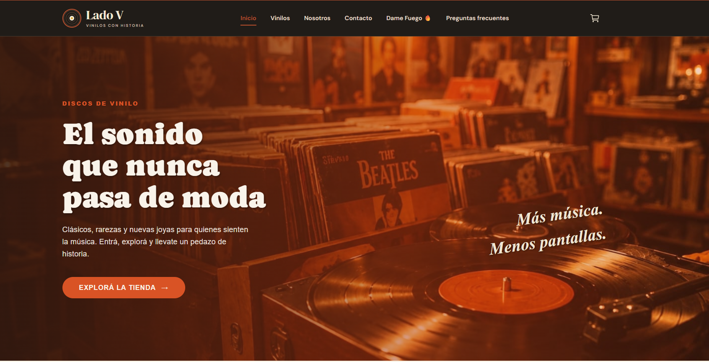
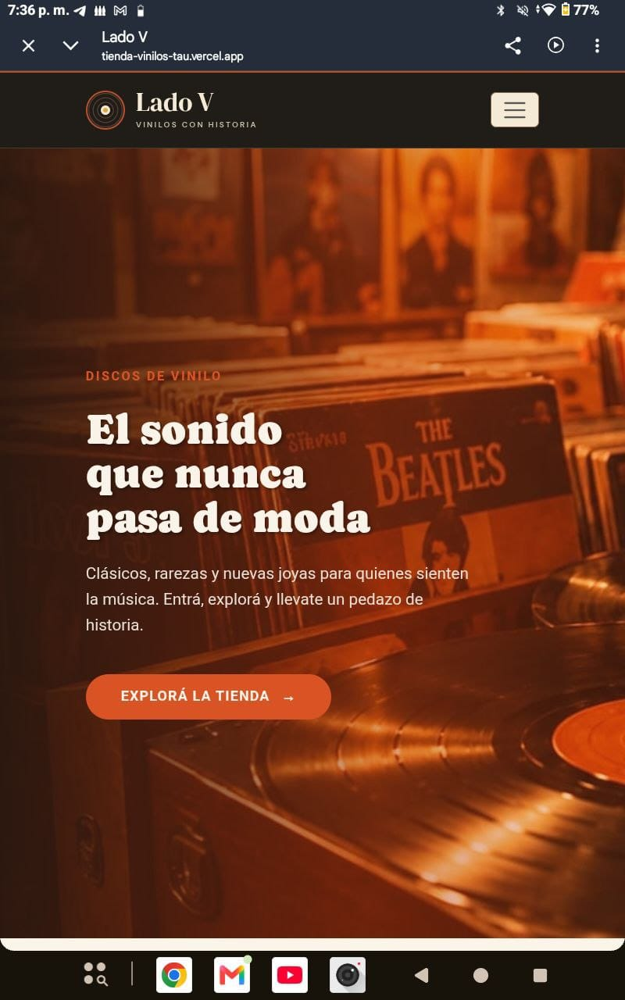
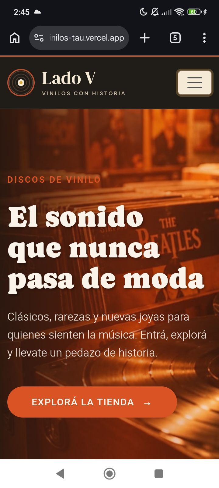
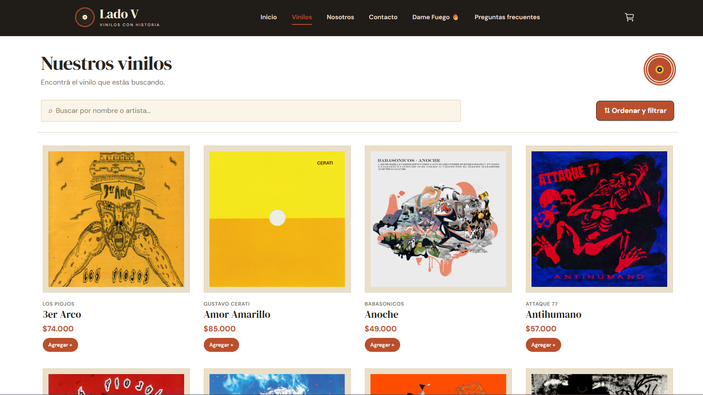
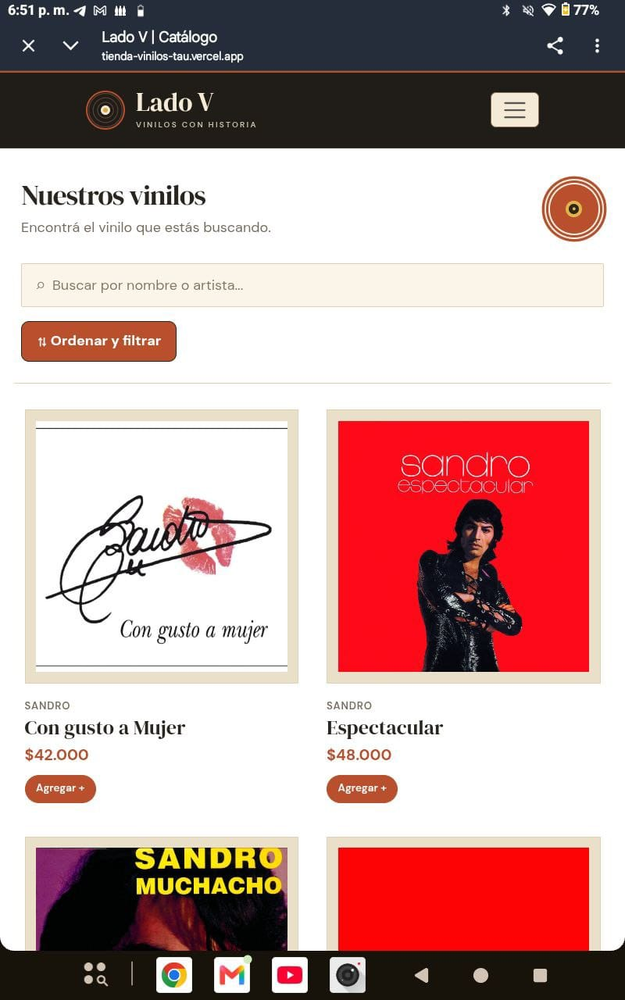
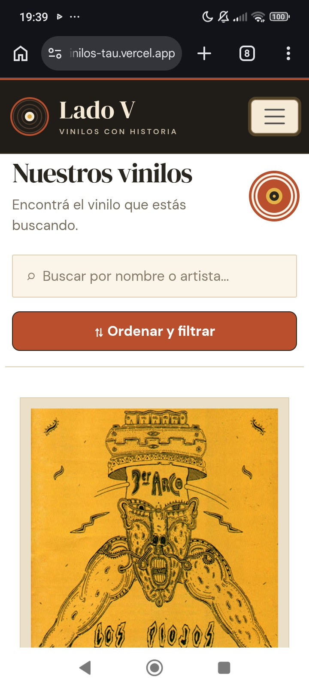
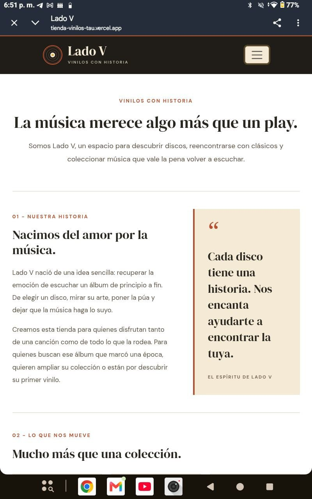
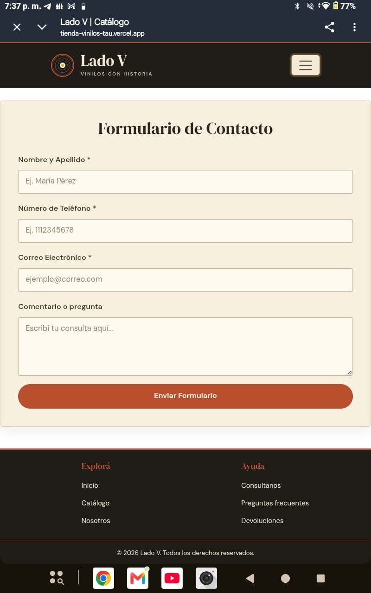

# 📀 Lado V - Vinilos con Historia ♬ 


## Descripción del Proyecto
**Lado V** es una aplicación web desarrollada en React que simula una tienda e-commerce de vinilos de música. Los usuarios pueden explorar el catálogo de productos, buscar y filtrar discos por categoría, precio o disponibilidad, consultar el detalle de cada vinilo, agregarlos a un carrito interactivo con persistencia local y simular la confirmación de la compra.

**Link del proyecto:** [Visitar Página](https://tienda-vinilos-tau.vercel.app/)

---

## Tecnologías Utilizadas


* **React** (Componentes funcionales y Hooks: `useState`, `useEffect`)
* **React Router** (Navegación SPA y rutas dinámicas)
* **React Bootstrap** & **CSS Modules** (Diseño responsivo y estilos encapsulados)
* **React Icons** (Iconografía de interfaz)
* **Vite** (Empaquetador y entorno de desarrollo)
* **JavaScript (ES6+)** (Lógica de carrito)

---

## 👥 Integrantes del Grupo
* **González Ortiz, Celeste Alejandra** - DNI: 44413462
* **Fajardo, Eugenia** - DNI: 33944035
* **Fogel, Facundo** - DNI:
* **Laginestra, Elisa** - DNI: 47308285

---

## Instalación y Ejecución Local

Para clonar y ejecutar el proyecto en una máquina local:

1. **Clonar el repositorio:**
   ```bash
   git clone https://github.com/laggeli/tienda-vinilos.git
   cd tienda-vinilos

2. **Instalar dependencias:**
    ```bash
    npm i
3. **Ejecutar el servidor de desarrollo:**
    ```bash
    npm run dev
4. **Abrir la dirección mostrada en la terminal (por ejemplo: http://localhost:5175) en el navegador.**

## Capturas de Pantalla

### 📱 Vistas del Proyecto (Diseño Responsivo)

| Desktop (PC) | Tablet | Mobile |
| :---: | :---: | :---: |
|  |  |  |
|  |  |  |
| |  | |
| |  | |
